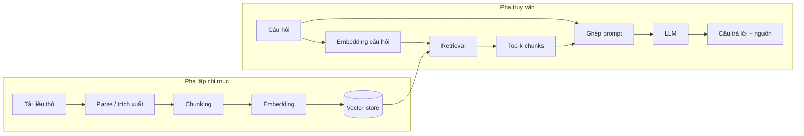

# RAG từ Cơ bản đến Triển khai

> Tài liệu tổng hợp thành tiếng Việt từ 7 bài viết trong thư mục **RAG Basics** của repository  
> [KalyanKS-NLP/rag-zero-to-hero-guide](https://github.com/KalyanKS-NLP/rag-zero-to-hero-guide/tree/main/RAG%20Basics).
>
> Mục tiêu của tài liệu là giới thiệu tổng quan về RAG là gì, vì sao cần RAG, cách hệ thống hoạt động, các thuật ngữ cốt lõi, lợi ích và thách thức, bộ công cụ phát triển, rồi chuyển thành kế hoạch học và triển khai thực tế.

---

## Mục lục

1. [RAG là gì?](#1-rag-là-gì)
2. [Vì sao cần RAG?](#2-vì-sao-cần-rag)
3. [Kiến trúc và quy trình hoạt động](#3-kiến-trúc-và-quy-trình-hoạt-động)
4. [Ví dụ xuyên suốt](#4-ví-dụ-xuyên-suốt)
5. [Các thuật ngữ cần biết](#5-các-thuật-ngữ-cần-biết)
6. [Lợi ích của RAG](#6-lợi-ích-của-rag)
7. [Thách thức và hướng xử lý](#7-thách-thức-và-hướng-xử-lý)
8. [RAG Developer Stack](#8-rag-developer-stack)
9. [Lộ trình học RAG](#9-lộ-trình-học-rag)
10. [Thiết kế một hệ thống RAG tối thiểu](#10-thiết-kế-một-hệ-thống-rag-tối-thiểu)
11. [Checklist đánh giá và vận hành](#11-checklist-đánh-giá-và-vận-hành)
12. [Tóm tắt nhanh](#12-tóm-tắt-nhanh)
13. [Nguồn tài liệu](#13-nguồn-tài-liệu)

---

## 1. RAG là gì?

**Retrieval-Augmented Generation (RAG)**, là kỹ thuật phổ biến giúp nâng cao chất lượng phản hồi của LLM bằng cách truy xuất các tri thức bên ngoài (external knowledge) từ một knowlegde base trước khi sinh ra câu trả lời. 
RAG giúp tăng độ chỉnh xác, giảm halluciations, và cho phép model cung cấp thông tin mới được cập nhật và phù hợp với ngữ cảnh hơn.
RAG bao gồm 3 bước:

- **Retrieval — truy xuất:** tìm kiếm thông tin liên quan trong một nguồn tri thức bên ngoài.
- **Augmentation — tăng cường ngữ cảnh**: ghép các đoạn tài liệu được tìm thấy vào prompt trước khi gửi cho LLM.
- **Generation — sinh câu trả lời:** sử dụng mô hình ngôn ngữ lớn (LLM) để tổng hợp câu trả lời dựa trên câu hỏi và thông tin vừa truy xuất.


```text
Câu hỏi người dùng (query)
        ↓
Truy xuất tài liệu liên quan (Retrieval)
        ↓
Ghép câu hỏi + ngữ cảnh + chỉ dẫn (Augmentation)
        ↓
LLM sinh câu trả lời (Generation)
```

RAG giúp LLM không cần “học lại” kiến thức theo cách re-train model bằng cách cung cấp kiến thức cần thiết **ngay tại thời điểm trả lời**.

### 1.1. Ba thành phần cốt lõi

1. **Knowlegde Base**

   Có thể là tài liệu PDF, trang web, wiki nội bộ, cơ sở dữ liệu, tài liệu kỹ thuật, hợp đồng, email, transcript video hoặc dữ liệu lấy từ API.

2. **Bộ truy xuất**

   Nhận câu hỏi và tìm các đoạn dữ liệu có khả năng chứa câu trả lời. Việc tìm kiếm có thể dựa trên từ khóa, embedding hoặc kết hợp cả hai.

3. **LLM**

   Nhận câu hỏi cùng ngữ cảnh được truy xuất, sau đó diễn giải, tổng hợp và tạo câu trả lời tự nhiên.

### 1.2. Các ứng dụng phổ biến

RAG phù hợp với những bài toán cần trả lời dựa trên một tập dữ liệu cụ thể hoặc thường xuyên thay đổi:

- Chatbot chăm sóc khách hàng dựa trên FAQ và tài liệu sản phẩm.
- Trợ lý tìm kiếm tài liệu kỹ thuật và mã nguồn.
- Phân tích hợp đồng, văn bản pháp lý và hồ sơ.
- Trợ lý nghiên cứu khoa học.
- Hỏi–đáp trên dữ liệu nội bộ doanh nghiệp.
- Hỗ trợ ra quyết định dựa trên tài liệu chuyên ngành.

> RAG đặc biệt hữu ích khi câu trả lời cần dựa trên **dữ liệu riêng**, **dữ liệu mới**, hoặc **nguồn có thể kiểm chứng**.

---

## 2. Vì sao cần RAG?

### 2.1. Knowlegde cut-off

LLM được huấn luyện trên dữ liệu thu thập đến một thời điểm nhất định. Các sự kiện, sản phẩm, chính sách hoặc tài liệu xuất hiện sau thời điểm đó có thể nằm ngoài kiến thức của mô hình.

RAG cho phép truy xuất thông tin từ nguồn được cập nhật mà không cần huấn luyện lại toàn bộ LLM.

### 2.2. Internal knowlegde

Một LLM phổ thông không tự biết:

- Quy trình nội bộ.
- Tài liệu sản phẩm chưa công bố.
- Chính sách nhân sự.
- Kho mã nguồn riêng.
- Hồ sơ khách hàng.
- Tài liệu dự án.

RAG tạo một “cầu nối” giữa LLM và kho tri thức riêng, đồng thời vẫn có thể kiểm soát quyền truy cập.

### 2.3. Hallucination

LLM tối ưu cho việc "dự đoán chuỗi từ" bằng việc dự đoán token tiếp theo, nên không phải lúc nào cũng là sự thật được xác minh. Khi thiếu dữ kiện, mô hình có thể tạo ra câu trả lời nghe thuyết phục nhưng sai.

RAG giảm rủi ro này bằng cách yêu cầu mô hình dựa trên ngữ cảnh đã truy xuất. Tuy nhiên, RAG **không loại bỏ hoàn toàn hallucination**; chất lượng vẫn phụ thuộc vào truy xuất, prompt và mô hình sinh.

### 2.4. Khó truy vết nguồn

Câu trả lời chỉ dựa trên “trí nhớ” của LLM thường khó kiểm chứng. Với RAG, mỗi đoạn ngữ cảnh có thể gắn metadata như:

- Tên tài liệu.
- URL.
- Số trang hoặc tiêu đề mục.
- Thời gian cập nhật.
- Chủ sở hữu tài liệu.

Nhờ đó, hệ thống có thể cung cấp trích dẫn hoặc liên kết về nguồn.

## 3. Kiến trúc và quy trình hoạt động

Một hệ thống RAG thông thường có 4 bước:

- **indexing:** xử lý kho tài liệu, thường chạy trước và chỉ chạy lại khi tài liệu thay đổi.
- **Pha truy vấn — query-time:** chạy cho mỗi câu hỏi của người dùng.



### 3.1. Bước 1 — Parse dữ liệu

Mục tiêu là chuyển tài liệu từ nhiều định dạng về biểu diễn có thể xử lý được:

- PDF → văn bản, bảng, tiêu đề, số trang.
- HTML → nội dung chính, bỏ menu và phần thừa.
- DOCX/PPTX → đoạn văn, bảng, slide.
- Hình ảnh hoặc PDF scan → OCR khi cần.
- Audio/video → transcript.

Một parser tốt không chỉ lấy chữ mà còn giữ được **cấu trúc và metadata**.

### 3.2. Bước 2 — Chunking

Tài liệu dài được chia thành các đoạn nhỏ gọi là **chunk**. Chunk quá lớn có thể chứa nhiều chủ đề và tốn context; chunk quá nhỏ dễ mất ngữ nghĩa.

Các chiến lược thường gặp:

- **Fixed-size chunking:** chia theo số ký tự hoặc token.
- **Chunk có overlap:** các đoạn chồng lấn để giảm mất ngữ cảnh ở ranh giới.
- **Recursive chunking:** ưu tiên chia theo tiêu đề, đoạn, câu rồi mới theo kích thước.
- **Semantic chunking:** chia khi chủ đề hoặc ngữ nghĩa thay đổi.
- **Structure-aware chunking:** dựa trên cấu trúc tài liệu như heading, bảng, trang.
- **Agentic chunking:** sử dụng mô hình để quyết định ranh giới hoặc nhóm thông tin.

Mỗi chunk nên đi kèm metadata:

```json
{
  "document_id": "employee-handbook-v3",
  "title": "Chính sách nghỉ phép",
  "section": "Nghỉ phép năm",
  "page": 18,
  "updated_at": "2026-05-12",
  "access_scope": "employees"
}
```

### 3.3. Bước 3 — Embedding

**Embedding** biến văn bản thành vector số có khả năng biểu diễn ý nghĩa. Các câu có ngữ nghĩa gần nhau thường có vector gần nhau trong không gian embedding.

Ví dụ:

```text
"Quy định nghỉ phép năm là gì?"
```

có thể gần về ngữ nghĩa với:

```text
"Nhân viên được hưởng 12 ngày nghỉ có lương mỗi năm."
```

dù hai câu không dùng hoàn toàn cùng từ khóa.

> Câu hỏi và tài liệu thường phải được mã hóa bằng cùng một embedding model hoặc các model tương thích.

### 3.4. Bước 4 — Lưu chỉ mục

Vector và metadata được lưu vào **vector store/vector database**. Hệ thống phải hỗ trợ:

- Tìm kiếm vector gần nhất.
- Lọc theo metadata.
- Thêm, sửa, xóa tài liệu.
- Quản lý namespace hoặc tenant.
- Đồng bộ khi tài liệu nguồn thay đổi.

### 3.5. Bước 5 — Mã hóa câu hỏi

Khi người dùng đặt câu hỏi, câu hỏi được chuyển thành embedding. Trước bước này, hệ thống có thể:

- Chuẩn hóa câu hỏi.
- Viết lại câu hỏi để rõ ý hơn.
- Tách câu hỏi phức hợp thành nhiều truy vấn.
- Bổ sung lịch sử hội thoại.
- Phân loại câu hỏi để chọn nguồn dữ liệu phù hợp.

### 3.6. Bước 6 — Retrieval

Vector câu hỏi được so sánh với các vector trong chỉ mục để lấy các chunk liên quan nhất.

Các kiểu retrieval:

- **Semantic search:** tìm theo độ gần embedding.
- **Keyword search:** tìm theo từ hoặc cụm từ, thường dùng BM25.
- **Hybrid search:** kết hợp semantic và keyword.
- **Metadata filtering:** lọc theo phòng ban, ngày tháng, loại tài liệu hoặc quyền truy cập.
- **Multi-query retrieval:** tạo nhiều biến thể truy vấn rồi hợp nhất kết quả.

Thông số quan trọng là `top_k`: số lượng chunk được lấy về. `top_k` quá thấp có thể bỏ sót thông tin; quá cao làm tăng nhiễu và chi phí token.

### 3.7. Bước 7 — Reranking

Retriever ban đầu ưu tiên tốc độ. Một **reranker** có thể chấm lại mức độ liên quan của các chunk rồi sắp xếp lại.

Luồng thường dùng:

```text
Lấy 20–50 chunk nhanh → rerank → chọn 3–10 chunk tốt nhất
```

Reranking thường tăng chất lượng nhưng làm tăng độ trễ và chi phí.

### 3.8. Bước 8 — Augmentation

Các chunk đã chọn được ghép với:

- Câu hỏi.
- Chỉ dẫn hệ thống.
- Quy tắc không bịa thông tin.
- Định dạng đầu ra.
- Yêu cầu trích dẫn.

Mẫu prompt:

```text
Bạn là trợ lý trả lời dựa trên tài liệu nội bộ.

Quy tắc:
1. Chỉ sử dụng thông tin trong CONTEXT.
2. Nếu CONTEXT không đủ, hãy nói rõ rằng chưa đủ thông tin.
3. Không tự suy đoán chính sách.
4. Trích dẫn nguồn theo dạng [Tên tài liệu, mục/trang].

CONTEXT:
{retrieved_chunks}

QUESTION:
{user_question}
```

### 3.9. Bước 9 — Generation

LLM tạo câu trả lời từ prompt đã tăng cường. Đầu ra tốt nên:

- Trả lời trực tiếp câu hỏi.
- Không thêm dữ kiện không được hỗ trợ.
- Tách rõ dữ kiện và suy luận.
- Có trích dẫn.
- Nêu giới hạn khi thiếu thông tin.

---


## 4. Các thuật ngữ cần biết

**Query**  
Câu hỏi hoặc đầu vào của người dùng, dùng để khởi động quá trình truy xuất và sinh câu trả lời.

**Document**  
Đơn vị tài liệu nguồn như PDF, trang web, email hoặc bản ghi cơ sở dữ liệu.

**Chunk**  
Một đoạn nhỏ được tách từ tài liệu lớn để lập chỉ mục và truy xuất.

**Chunking**  
Quá trình chia tài liệu thành các chunk có ý nghĩa.

**Metadata**  
Thông tin mô tả chunk hoặc tài liệu: nguồn, tiêu đề, trang, thời gian, quyền truy cập.

**Embedding**  
Vector số biểu diễn nội dung hoặc ý nghĩa của văn bản.

**Embedding model**  
Mô hình chuyển câu, đoạn hoặc tài liệu thành embedding.

**Indexing**  
Quá trình chuẩn bị dữ liệu để tìm kiếm: parse, chunk, embed và lưu chỉ mục.

**Vector store / Vector database**  
Hệ thống lưu vector và tìm các vector gần nhau.

**Similarity**  
Mức độ gần nhau giữa hai vector, thường dùng cosine similarity, dot product hoặc khoảng cách Euclid.

**Retrieval**  
Quá trình lấy các chunk liên quan đến query.

**Semantic search**  
Tìm kiếm dựa trên ý nghĩa thông qua embedding.

**Keyword search**  
Tìm kiếm dựa trên từ khóa xuất hiện trong văn bản.

**Hybrid search**  
Kết hợp semantic search và keyword search.

**Top-k**  
Số kết quả retrieval được lấy về.

**Recall**  
Khả năng lấy đủ các tài liệu thực sự liên quan.

**Precision**  
Tỷ lệ kết quả lấy về thực sự liên quan.

**Reranking**  
Chấm và sắp xếp lại kết quả retrieval bằng mô hình chính xác hơn.

**Augmentation**  
Đưa thông tin được truy xuất vào prompt.

**Context**  
Phần dữ liệu nền được cung cấp cho LLM.

**Context window**  
Số token tối đa mô hình có thể xử lý trong một lần gọi.

**Prompt**  
Đầu vào hoàn chỉnh gửi cho LLM, gồm chỉ dẫn, context và query.

**Prompt engineering**  
Thiết kế prompt để mô hình hiểu mục tiêu, giới hạn và định dạng đầu ra.

**Generation**  
Quá trình LLM tạo câu trả lời.

**Temperature**  
Thông số điều khiển mức ngẫu nhiên. Với hỏi–đáp dựa trên dữ kiện, thường ưu tiên temperature thấp.

**Response**  
Câu trả lời cuối cùng trả về cho người dùng.

**Grounding**  
Mức độ câu trả lời được hỗ trợ bởi tài liệu đã truy xuất.

**Citation**  
Thông tin chỉ ra nguồn hỗ trợ cho một phát biểu.

---

## 5. Lợi ích của RAG

**5.1. Cải thiện độ chính xác**

LLM được cung cấp dữ liệu liên quan thay vì chỉ dựa vào kiến thức tham số. Điều này đặc biệt hữu ích với câu hỏi chi tiết, chuyên ngành hoặc thuộc dữ liệu nội bộ.

**6.2. Hỗ trợ dữ liệu cập nhật**

Có thể cập nhật kho tri thức và lập chỉ mục lại mà không cần huấn luyện lại LLM. Với dữ liệu thay đổi nhanh, đây là lợi thế lớn về thời gian và chi phí.

**6.3. Tăng tính liên quan theo ngữ cảnh**

Retriever chọn thông tin theo từng query, giúp LLM tập trung vào phần dữ liệu phù hợp thay vì đọc toàn bộ kho tài liệu.

**6.4. Giảm hallucination**

Khi prompt buộc mô hình chỉ trả lời dựa trên context và từ chối khi thiếu dữ kiện, khả năng tạo thông tin không có căn cứ giảm đáng kể.

**6.5. Tiết kiệm hơn so với retraining thường xuyên**

Cập nhật tài liệu và embedding thường nhẹ hơn huấn luyện hoặc fine-tuning lại mô hình lớn mỗi khi tri thức thay đổi.

  **6.6. Tăng niềm tin và khả năng kiểm chứng**

Câu trả lời có thể gắn nguồn, số trang và đường dẫn. Người dùng hoặc chuyên gia có thể mở tài liệu để kiểm tra.

  **6.7. Xử lý tốt chủ đề hẹp**

RAG có thể khai thác kho tri thức chuyên biệt mà LLM phổ thông ít gặp trong dữ liệu huấn luyện.

  **6.8. Kiểm soát dữ liệu linh hoạt**

Có thể áp dụng:

- Phân quyền theo người dùng.
- Lọc theo phòng ban.
- Tách tenant.
- Xóa tài liệu khỏi chỉ mục.
- Giới hạn nguồn được phép sử dụng.

---

## 7. Thách thức và hướng xử lý

  **7.1. Retrieval không chính xác**

**Vấn đề:** lấy sai hoặc bỏ sót chunk chứa câu trả lời.

**Nguyên nhân thường gặp:**

- Chunking không phù hợp.
- Embedding model không hợp ngôn ngữ hoặc lĩnh vực.
- Query quá ngắn hoặc mơ hồ.
- Chỉ dùng semantic search cho dữ liệu nhiều mã, tên riêng hoặc số hiệu.

**Hướng xử lý:**

- Thử nhiều kích thước chunk và overlap.
- Dùng hybrid search.
- Viết lại query.
- Thêm metadata filter.
- Dùng reranker.
- Đánh giá retrieval trên bộ câu hỏi có nhãn.

  **7.2. Context có liên quan nhưng không đủ**

**Vấn đề:** các chunk riêng lẻ đúng chủ đề nhưng thiếu phần cần thiết để trả lời.

**Hướng xử lý:**

- Lưu quan hệ giữa các chunk lân cận.
- Truy xuất theo parent–child.
- Mở rộng cửa sổ xung quanh chunk trúng.
- Tạo summary cho tài liệu dài.
- Sử dụng multi-hop retrieval cho câu hỏi cần nhiều bước.

  **7.3. Nhiễu và mâu thuẫn**

**Vấn đề:** tài liệu lỗi thời, nhiều phiên bản hoặc nguồn bất đồng.

**Hướng xử lý:**

- Gắn ngày hiệu lực và phiên bản.
- Ưu tiên nguồn chính thức.
- Lọc tài liệu đã hết hiệu lực.
- Yêu cầu LLM nêu rõ khi nguồn mâu thuẫn.
- Thiết lập quy tắc xếp hạng nguồn.

  **7.4. Độ trễ**

Pipeline có thể gồm query rewrite, nhiều lần retrieval, reranking và gọi LLM nên chậm hơn gọi LLM trực tiếp.

**Hướng xử lý:**

- Cache embedding và kết quả phổ biến.
- Giới hạn số nguồn và `top_k`.
- Dùng model nhỏ cho rewrite/rerank.
- Chạy song song các retriever.
- Stream câu trả lời.
- Theo dõi latency theo từng bước.

  **7.5. Khả năng mở rộng**

Kho dữ liệu lớn làm tăng thời gian lập chỉ mục, dung lượng vector và độ phức tạp cập nhật.

**Hướng xử lý:**

- Incremental indexing.
- Sharding hoặc namespace.
- Batch embedding.
- Xóa dữ liệu trùng.
- Chọn vector database phù hợp quy mô.
- Theo dõi chi phí lưu trữ và truy vấn.

  **7.6. Hallucination vẫn có thể xảy ra**

Ngay cả khi context đúng, LLM vẫn có thể diễn giải quá mức hoặc ghép thông tin sai.

**Hướng xử lý:**

- Prompt quy định “không đủ dữ liệu thì từ chối”.
- Temperature thấp.
- Citation bắt buộc.
- Kiểm tra claim–evidence sau khi sinh.
- Dùng structured output.
- Đánh giá faithfulness/groundedness.

**7.7. Bias, bảo mật và quyền truy cập**

Dữ liệu truy xuất có thể chứa thiên lệch, nội dung độc hại hoặc thông tin nhạy cảm.

**Hướng xử lý:**

- Phân quyền trước retrieval, không chỉ sau generation.
- Lọc PII và dữ liệu mật.
- Ghi log truy cập.
- Chống prompt injection trong tài liệu.
- Kiểm tra nguồn trước khi ingest.
- Không đưa dữ liệu vượt quyền vào prompt.

  **7.8. Đánh giá khó**

Một câu trả lời có thể trôi chảy nhưng sai; retrieval tốt nhưng LLM dùng context không đúng; hoặc câu trả lời đúng nhưng nguồn không hỗ trợ đầy đủ.

Vì vậy cần đánh giá riêng:

1. **Retriever:** có lấy đúng tài liệu không?
2. **Generator:** có trả lời đúng và bám nguồn không?
3. **End-to-end:** người dùng có nhận được câu trả lời hữu ích không?

---

### 8. RAG Stack 

**RAG (Retrieval-Augmented Generation)** là một kiến trúc kết hợp giữa **mô hình ngôn ngữ lớn (LLM)** và **hệ thống truy xuất dữ liệu (Retriever)** để giúp AI trả lời chính xác hơn dựa trên dữ liệu riêng hoặc tài liệu bên ngoài.

Một **RAG Developer Stack** thường bao gồm 7 nhóm công nghệ chính:

RAG (Retrieval-Augmented Generation) là kiến trúc kết hợp **LLM** với
**truy xuất dữ liệu (Retrieval)** để tạo ra câu trả lời chính xác hơn
dựa trên tài liệu bên ngoài hoặc dữ liệu nội bộ.

**1. LLMs**

Là mô hình ngôn ngữ lớn, chịu trách nhiệm hiểu câu hỏi và sinh câu trả
lời.

**Ví dụ:** Llama 3.3, Phi-4, Gemma 3, Qwen 2.5, Mistral, DeepSeek,
OpenAI, Claude, Gemini, Cohere, Amazon.

**2. LLM Frameworks**

Cung cấp các thành phần như Prompt, Retriever, Agent và RAG Pipeline,
giúp phát triển ứng dụng AI nhanh hơn.

**Ví dụ:** LangChain, LlamaIndex, Haystack, txtai.

**3. Vector Databases**

Lưu trữ embedding dưới dạng vector và hỗ trợ tìm kiếm ngữ nghĩa để truy
xuất tài liệu liên quan.

**Ví dụ:** Chroma, Pinecone, Qdrant, Weaviate, Milvus.
**4. Data Extraction**

Trích xuất dữ liệu từ Website, PDF, Word, PowerPoint, hình ảnh... trước
khi chia nhỏ (chunking) và tạo embedding.

**Ví dụ:** Crawl4AI, FireCrawl, ScrapeGraphAI, MegaParser, Docling,
LlamaParse, ExtractThinker.

**5. Open LLM Access**

Nền tảng giúp chạy hoặc truy cập các mô hình mã nguồn mở trên máy cục bộ
hoặc qua API.

**Ví dụ:** Hugging Face, Ollama, Groq, Together AI.

**6. Text Embeddings**

Chuyển văn bản thành vector để phục vụ tìm kiếm theo ngữ nghĩa trong
RAG.

**Ví dụ:** Nomic, SBERT, BGE, Ollama Embeddings, OpenAI Embeddings,
Voyage AI, Google, Cohere.

**7. Evaluation**

Đánh giá chất lượng hệ thống RAG về khả năng truy xuất, độ chính xác và
mức độ hallucination.

**Ví dụ:** Giskard, RAGAS, TruLens.

 Tóm tắt quy trình

``` text
Data Sources
    ↓
Data Extraction
    ↓
Chunking
    ↓
Embeddings
    ↓
Vector Database
    ↓
Retriever
    ↓
LLM
    ↓
Final Answer
    ↓
Evaluation
```


## 10. Thiết kế một hệ thống RAG tối thiểu

### 10.1. Pseudocode lập chỉ mục

```python
documents = load_documents(source)

chunks = []
for document in documents:
    parsed = parse(document)
    document_chunks = split_text(
        parsed.text,
        chunk_size=500,
        overlap=80,
    )
    chunks.extend(
        attach_metadata(document_chunks, parsed.metadata)
    )

vectors = embedding_model.embed([chunk.text for chunk in chunks])
vector_store.upsert(vectors=vectors, payloads=chunks)
```

### 10.2. Pseudocode truy vấn

```python
def answer(question: str) -> dict:
    query_vector = embedding_model.embed_query(question)

    candidates = vector_store.search(
        vector=query_vector,
        top_k=20,
        filters=current_user_access_filter(),
    )

    ranked = reranker.rank(
        query=question,
        documents=candidates,
    )

    context = build_context(ranked[:5])

    prompt = build_prompt(
        question=question,
        context=context,
        require_citations=True,
        refuse_when_insufficient=True,
    )

    response = llm.generate(
        prompt=prompt,
        temperature=0.1,
    )

    return {
        "answer": response.text,
        "sources": extract_sources(ranked[:5]),
    }
```
