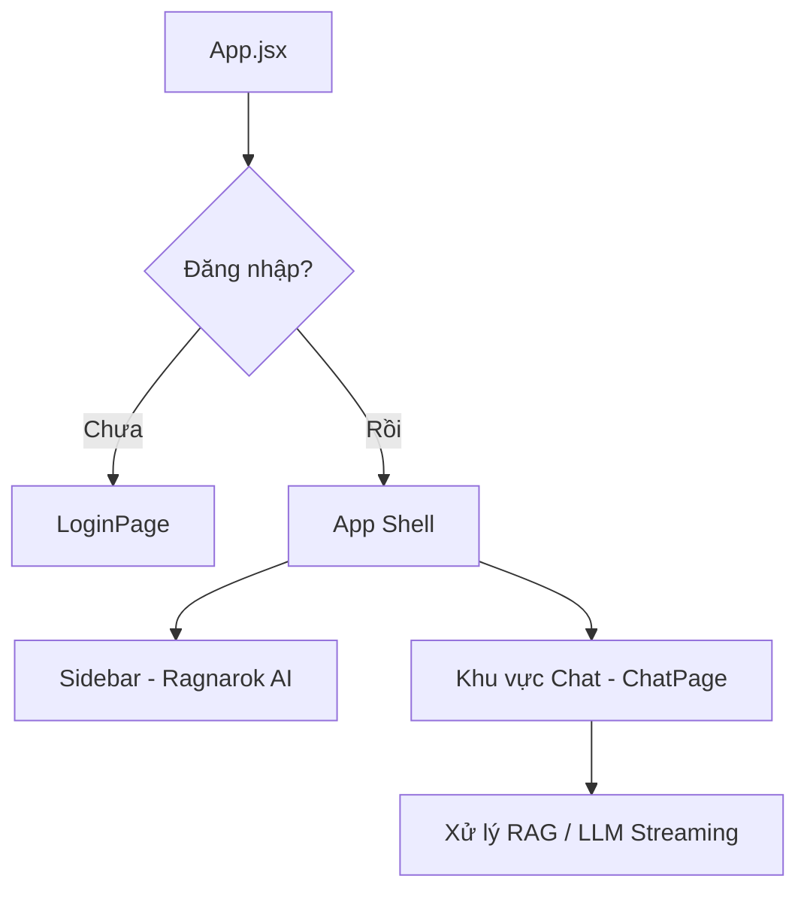

# Ragnarok AI - Tài liệu Kiến trúc Frontend

Tài liệu này giới thiệu chi tiết toàn bộ cấu trúc giao diện (Frontend) của dự án **Ragnarok Multi-Tenant RAG Gateway**, được thiết kế và tối ưu theo phong cách giao diện cao cấp Light Theme của ChatGPT.

---

## 1. Kiến trúc Tổng quan (Architecture Overview)

Frontend được xây dựng bằng **React + Vite** với mục tiêu tối ưu hóa trải nghiệm người dùng, đảm bảo hiệu ứng mượt mà (transitions) và giao tiếp ổn định với Backend API.

### Sơ đồ luồng hoạt động giao diện:


---

## 2. Các Thành phần Giao diện & Feature Chính

### 2.1. Xác thực người dùng (Auth Feature)
- **Tập tin chính**: [AuthContext.jsx](file:///C:/My_data/Work_spaces/253/ragnarok-multi-tenant-rag-api-gateway/ragnarok-multi-tenant-rag-api-gateway-feature-s2-frontend/ragnarok-ui/src/context/AuthContext.jsx) & [LoginPage.jsx](file:///C:/My_data/Work_spaces/253/ragnarok-multi-tenant-rag-api-gateway/ragnarok-multi-tenant-rag-api-gateway-feature-s2-frontend/ragnarok-ui/src/features/auth/pages/LoginPage.jsx)
- **Chức năng**:
  - Quản lý trạng thái người dùng đăng nhập qua `localStorage` (khóa `ragnarok_user`).
  - Giao diện đăng nhập chuẩn Light Theme: Form nhập liệu bo góc, hiển thị thông báo lỗi rung lắc (shake animation) khi nhập sai tài khoản, và hiệu ứng pulsing logo thương hiệu.
  - Hỗ trợ mô phỏng đăng nhập nhanh một chạm qua Google, Microsoft và Apple.

### 2.2. Trò chuyện & Giả lập RAG (Chat Feature)
- **Tập tin chính**: [ChatContext.jsx](file:///C:/My_data/Work_spaces/253/ragnarok-multi-tenant-rag-api-gateway/ragnarok-multi-tenant-rag-api-gateway-feature-s2-frontend/ragnarok-ui/src/context/ChatContext.jsx), [ChatPage.jsx](file:///C:/My_data/Work_spaces/253/ragnarok-multi-tenant-rag-api-gateway/ragnarok-multi-tenant-rag-api-gateway-feature-s2-frontend/ragnarok-ui/src/features/chat/pages/ChatPage.jsx), [ChatWindow.jsx](file:///C:/My_data/Work_spaces/253/ragnarok-multi-tenant-rag-api-gateway/ragnarok-multi-tenant-rag-api-gateway-feature-s2-frontend/ragnarok-ui/src/features/chat/components/ChatWindow.jsx)
- **Chức năng**:
  - Lưu và khôi phục lịch sử chat theo từng tài khoản qua `localStorage` (khóa `ragnarok_conversations`).
  - **Màn hình chào mừng (Hero)**: Tích hợp lưới 4 gợi ý thông minh (nhấp để gửi nhanh), logo thương hiệu tinh gọn `64px`, tiêu đề đậm nét `36px` có khoảng trắng rộng rãi.
  - **Hộp nhập liệu nổi (Chat Input)**: 
    - Bo góc tròn toàn diện `28px`, nền trắng tinh khiết, loại bỏ hoàn toàn viền và bổ sung đổ bóng nổi mượt mà.
    - Ẩn thanh cuộn (scrollbar) đối với các câu chat ngắn, tự động mở rộng chiều cao và hiển thị thanh cuộn khi văn bản vượt quá `180px`.
    - Nút gửi đổi màu động (xám khi chưa nhập, đen tuyền khi đã sẵn sàng gửi).
  - **Giả lập luồng RAG & LLM Streaming**:
    - Mô phỏng quá trình truy xuất từ cơ sở dữ liệu Vector DB (Qdrant) theo từng bước trực quan.
    - Sinh văn bản chạy từng từ (token streaming) kèm nguồn trích dẫn thật (Citations).
    - Các thẻ nguồn (Citation Card) khi hover chuột sẽ mở ra tooltip overlay chứa nội dung trích xuất chi tiết.

### 2.3. Thanh điều hướng bên (Sidebar Component)
- **Tập tin chính**: [Sidebar.jsx](file:///C:/My_data/Work_spaces/253/ragnarok-multi-tenant-rag-api-gateway/ragnarok-multi-tenant-rag-api-gateway-feature-s2-frontend/ragnarok-ui/src/shared/components/layout/Sidebar.jsx)
- **Chức năng**:
  - Tối giản hóa tối đa không gian: Loại bỏ các liên kết tab menu khác, tập trung hoàn toàn vào lịch sử chat.
  - Nút đóng/mở panel bên `[|]` đặt cạnh logo thương hiệu **Ragnarok AI** (cỡ chữ `21px` in đậm).
  - Nút **"Đoạn chat mới"** phẳng, không viền, nền trong suốt đổi màu khi hover, sử dụng biểu tượng Bút viết đặc trưng của ChatGPT.
  - Các cuộc hội thoại có chiều cao dòng cố định `40px`, khoảng cách icon-chữ `12px`, hover chuyển màu `#ECECEC`, active bôi đậm `#E8E8E8` với hiệu ứng chuyển đổi `150ms`.
  - Tiêu đề **"Trò chuyện gần đây"** viết hoa chữ cái đầu và in đậm (`font-weight: 700`).

---

## 3. Hệ thống Token Màu sắc (Design System)

Giao diện áp dụng bảng màu Light Theme nhất quán thông qua các biến CSS tại `:root` trong [globals.css](file:///C:/My_data/Work_spaces/253/ragnarok-multi-tenant-rag-api-gateway/ragnarok-multi-tenant-rag-api-gateway-feature-s2-frontend/ragnarok-ui/src/styles/globals.css):

```css
:root {
  --sidebar-bg: #F9F9F9;        /* Nền Sidebar */
  --sidebar-hover: #ECECEC;     /* Nền mục bên Sidebar khi di chuột */
  --sidebar-active: #E8E8E8;    /* Nền mục chat đang mở */
  --border: #ECECEC;            /* Đường viền phân cách mỏng */
  --text-primary: #111111;      /* Chữ chính */
  --text-secondary: #6B7280;    /* Chữ phụ, nhãn */
  
  --chat-bg: #FCFCFC;           /* Nền khu vực Chat */
  --input-bg: #FAFAFA;          /* Nền trong ô nhập */
  --message-user: #F3F3F3;      /* Bong bóng chat của người dùng */
  --scrollbar: #D0D0D0;         /* Màu thanh cuộn */
}
```

---

## 4. Hướng dẫn Phát triển & Chạy Dự án

### Khởi chạy môi trường local:
```bash
# Di chuyển đến thư mục UI
cd ragnarok-ui

# Cài đặt thư viện
npm install

# Khởi động máy chủ dev (mặc định http://localhost:5173)
npm run dev
```

### Biên dịch production:
```bash
npm run build
```
Mã nguồn sau biên dịch sẽ được đặt trong thư mục `dist/`, sẵn sàng triển khai qua Nginx hoặc các CDN tĩnh.
